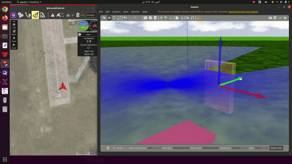
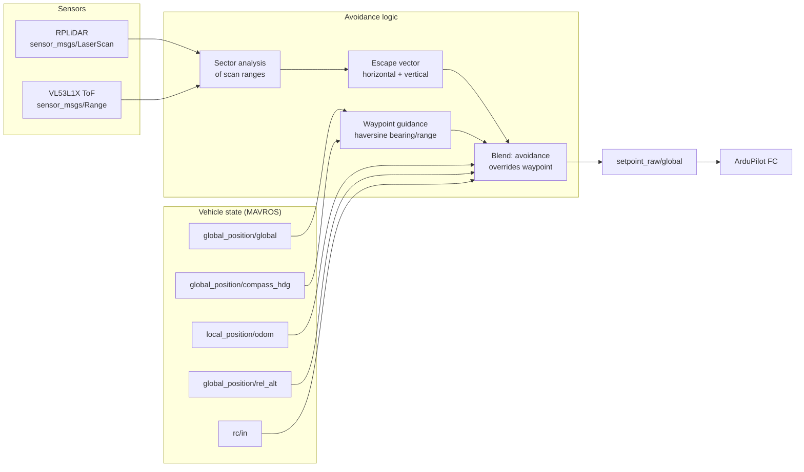

# UAV Obstacle Avoidance — LiDAR + ToF, GPS Waypoint Navigation

Reactive obstacle avoidance for a MAVROS/ArduPilot multirotor. Two modes:
pure reactive avoidance, and avoidance layered underneath GPS waypoint
navigation so the aircraft reaches its target while flying around what is in
the way.



▶️ **[Full demo video](https://youtu.be/REPLACE_WITH_YOUR_LINK)**

---

## What it does

| mode | entry point | behaviour |
|---|---|---|
| Reactive only | `avoidance.py` → `run_avoidance_only()` | Holds position, steers away from obstacles as they appear |
| Waypoint + avoidance | `gps_avoidance.py` → `move_drone_to_coordinates()` | Flies to a GPS target, deviating around obstacles, then resumes course |

Both vertical and horizontal avoidance are handled — the aircraft will climb
over an obstacle where that is the better escape, rather than only yawing
around it.

## System architecture



## Repository layout

```
src/
    avoidance.py       ObstacleAvoidanceOnly — reactive mode
    gps_avoidance.py   ObstacleAvoidanceHelper + move_drone_to_coordinates()
                       waypoint navigation with avoidance layered under it,
                       haversine_distance() for range-to-target
    Drone_API.py       MAVROS wrapper: state, setpoints, arming, modes
    custom_API.py      higher-level helpers built on Drone_API
    Drone_Data.py      telemetry data containers
    take_off.py        guarded takeoff to a target altitude
```

## MAVROS interface

Subscribes:
```
/drone1/mavros/state
/drone1/mavros/global_position/global
/drone1/mavros/global_position/local
/drone1/mavros/global_position/rel_alt
/drone1/mavros/global_position/compass_hdg
/drone1/mavros/local_position/odom
/drone1/mavros/rc/in
```

Publishes:
```
/drone1/mavros/setpoint_raw/global
```

The `/drone1` namespace is configurable — it exists so several aircraft can run
the same stack side by side.

## Dependencies

Not vendored here — install separately:

- [`rplidar_ros`](https://github.com/Slamtec/rplidar_ros) — LiDAR driver
- `vl53l1x_ros` — ToF rangefinder driver
- MAVROS + ArduPilot (tested against ArduCopter)

## Running

```bash
# with MAVROS up and the FC connected
rosrun <your_package> take_off.py          # climb to altitude
rosrun <your_package> avoidance.py         # reactive avoidance
# or
rosrun <your_package> gps_avoidance.py     # waypoint nav with avoidance
```

## Safety

This arms and flies a real aircraft. Test reactive avoidance at low altitude
over open ground before trusting it on a waypoint mission, and keep a pilot on
the sticks able to take the mode switch at any time.
